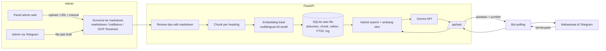

# Tanya Kampus

Chatbot Telegram berbasis RAG + LLM untuk informasi akademik dan tugas akhir. Mahasiswa bertanya, sistem mencari bagian dokumen resmi yang relevan, Gemini menyusun jawaban dari bagian itu, dan jawaban selalu disertai sumbernya. Admin mengelola knowledge lewat panel web.

Proyek Teknologi Informasi 23-003. Versi ini (V1) berfokus pada sistem inti yang bisa didemokan. Deployment sengaja ditunda.

## Fitur V1

- **Tanya jawab di Telegram**: `/start`, `/tanya <pertanyaan>`, atau ketik langsung di chat pribadi. Jawaban disertai sumber (judul dokumen, bagian, tanggal berlaku) dan tombol feedback.
- **Panel admin web** (`/admin/`): upload banyak file sekaligus (PDF/DOCX/PPTX/XLSX/HTML/CSV/MD/TXT dan gambar), tambah dari URL, atau tulis manual. Hasil konversi ke markdown bisa **ditinjau dan diedit** sebelum di-index, atau pilih "Langsung index". Ada pencarian dan filter dokumen, lihat chunk, index ulang, hapus, tes tanya dengan skor per chunk, dan log pertanyaan.
- **OCR**: PDF hasil scan, PDF campuran (sebagian halaman scan), dan gambar (PNG/JPG/TIFF/BMP) dibaca dengan Tesseract. Hasil OCR diberi catatan di panel admin supaya angka, tanggal, dan tabel diperiksa sebelum di-index.
- **Deteksi duplikat**: file dengan isi yang sama dengan dokumen yang sudah ada ditolak (atau dilewati pada upload massal).
- **File asli untuk mahasiswa** (opsional per dokumen): bila admin mencentang "Izinkan bot mengirim file asli", jawaban yang bersumber dari dokumen itu menampilkan tombol unduh (mis. template, formulir).
- **Admin lewat Telegram** (opsional): admin yang terdaftar mengirim file ke bot, hasilnya menjadi draft untuk ditinjau di panel.
- **Guardrail**: ambang skor retrieval, instruksi "hanya dari konteks" ke LLM, dan jawaban "tidak ditemukan" yang jelas. Pertanyaan yang tidak terjawab tercatat di log, jadi admin tahu knowledge apa yang kurang.
- **Hybrid search**: embedding semantik + keyword (SQLite FTS5) + cakupan kata, dengan filter kategori.
- **Gratis dan open source** kecuali panggilan Gemini (free tier).

## Arsitektur



Alur tanya: pertanyaan → embed → hybrid search (top 5) → cek ambang skor → prompt ke Gemini dengan konteks → jawaban + sumber → log.

Keputusan desain yang perlu diketahui:

| Keputusan | Alasan |
|---|---|
| Satu file SQLite untuk semuanya | Setup nol, backup tinggal copy. Cukup untuk ribuan sampai puluhan ribu chunk. |
| Markdown disimpan sebagai sumber kebenaran | Ganti model embedding cukup re-index dari markdown, tanpa konversi ulang. |
| Matriks embedding di-cache di memori | Query tidak membaca semua vektor dari disk. Cache dibuang otomatis saat `index_version` berubah. |
| Bot memanggil API lewat HTTP | Model embedding hanya dimuat sekali (di API). Bot ringan. |
| Chunk lama diganti atomik saat index ulang | Dokumen tidak "menghilang" selama proses embedding. |

## Struktur repo

```
tanya-kampus/
├── app/
│   ├── maintenance.py     # pembersihan log lama, warm-up model
│   ├── main.py            # FastAPI app, startup, static admin
│   ├── config.py          # semua pengaturan dari .env
│   ├── db.py              # skema SQLite + FTS5
│   ├── security.py        # bcrypt, JWT, API key bot
│   ├── deps.py            # objek berat (embedder, pipeline) dibuat sekali
│   ├── api/               # endpoint: auth, documents, ask, admin
│   ├── rag/               # embeddings, chunker, search, llm, prompt, pipeline
│   ├── ingestion/         # converter, ocr, dan service (CRUD + index)
│   ├── bot/               # bot Telegram + formatting
│   └── static/admin/      # panel admin (HTML/CSS/JS, tanpa build step)
├── scripts/               # create_admin, seed_demo, doctor (cek kesiapan), backup
├── eval/                  # test set + run_eval (kalibrasi ambang)
├── tests/                 # pytest
├── data/sample/           # 2 dokumen contoh (fiktif)
├── Dockerfile, docker-compose.yml   # belum diuji
└── .env.example
```

Untuk pembagian kerja: Backend & RAG di `app/rag`, `app/api`, `app/deps.py`. Data Engineer di `app/ingestion`, `data/`. Bot UX di `app/bot`, `app/rag/prompt.py` (gaya jawaban) dan `app/static/admin`. QA di `tests/` dan `eval/`.

## Mulai cepat

Prasyarat: Python 3.11 atau lebih baru, dan (untuk OCR) program Tesseract. Koneksi internet untuk pemasangan paket dan unduhan model embedding pertama kali (sekitar 0,5 GB), setelah itu embedding berjalan offline.

```bash
# 1. Lingkungan dan dependensi
python3 -m venv .venv
source .venv/bin/activate            # Windows: .venv\Scripts\activate
pip install -r requirements.txt

# 1b. Tesseract untuk OCR (lewati bila tidak perlu membaca PDF scan/gambar)
#   Ubuntu/Debian: sudo apt install tesseract-ocr tesseract-ocr-ind tesseract-ocr-eng
#   macOS:         brew install tesseract tesseract-lang
#   Windows:       pasang dari https://github.com/UB-Mannheim/tesseract/wiki (centang bahasa Indonesian),
#                  lalu tambahkan folder instalasi ke PATH

# 2. Konfigurasi
cp .env.example .env
python -c "import secrets; print(secrets.token_hex(32))"   # tempel hasilnya ke SECRET_KEY
# Isi juga: ADMIN_PASSWORD, GEMINI_API_KEY (https://aistudio.google.com/apikey), BOT_API_KEY

# 3. Cek kesiapan (menunjukkan persis apa yang masih kurang)
python -m scripts.doctor

# 4. Muat dokumen contoh (opsional, untuk demo cepat)
python -m scripts.seed_demo

# 5. Jalankan API + panel admin
uvicorn app.main:app --reload
# Panel admin:  http://127.0.0.1:8000/admin/
# Docs API:     http://127.0.0.1:8000/docs
```

`python -m scripts.doctor --live` sekaligus menguji model embedding, satu panggilan Gemini, token Telegram, dan API yang sedang jalan. Jalankan setelah `.env` terisi.

Login dengan `ADMIN_USERNAME` dan `ADMIN_PASSWORD` dari `.env`. Admin dibuat otomatis saat API pertama kali jalan. Untuk admin tambahan atau reset password: `python -m scripts.create_admin`.

### Menyalakan bot Telegram

1. Di Telegram, chat ke [@BotFather](https://t.me/BotFather), kirim `/newbot`, pilih nama dan username (berakhiran `bot`). Salin token-nya ke `TELEGRAM_TOKEN` di `.env`.
2. Pastikan `BOT_API_KEY` terisi (nilainya dipakai bersama oleh bot dan API) dan API sedang jalan.
3. Di terminal lain: `python -m app.bot.telegram_bot`
4. Buka bot di Telegram, kirim `/start`, lalu tanyakan sesuatu.

Bot menjawab sapaan dan ucapan terima kasih tanpa memanggil LLM, menolak pesan non-teks dengan ramah, dan membatasi frekuensi tanya per pengguna (`BOT_COOLDOWN_SECONDS`).

Untuk fitur kirim file sebagai admin: kirim `/id` ke bot, masukkan angkanya ke `ADMIN_TELEGRAM_IDS`, restart bot. File yang dikirim menjadi **draft**; tinjau dan klik Index di panel admin. Judul diambil dari caption file.

Token bot adalah rahasia. Jangan di-commit. Kalau bocor, buat ulang lewat BotFather (`/revoke`).

### Tanpa API key atau tanpa unduhan model

Untuk mencoba alur lengkap secara offline (kualitas rendah, hanya untuk uji alur):

```bash
EMBEDDING_BACKEND=hashing LLM_PROVIDER=extractive uvicorn app.main:app --reload
```

`hashing` mengganti model embedding dengan hash kata. `extractive` menjawab dengan mengutip potongan dokumen tanpa LLM (bisa juga dipakai sebagai cadangan bila kuota Gemini habis).

## Cara kerja

**Ingestion.** File atau URL dikonversi ke markdown (`markitdown` untuk dokumen, `trafilatura` untuk halaman web), dirapikan, lalu disimpan sebagai draft. Admin meninjau dan mengedit markdown, lalu menekan Index.

**OCR** (`app/ingestion/ocr.py`). PDF dicek per halaman: bila tidak ada teks sama sekali atau minimal separuh halaman nyaris kosong, seluruh halaman di-OCR. Bila hanya sebagian halaman yang kosong, teks asli dipertahankan dan halaman kosong di-OCR lalu ditambahkan sebagai "Halaman N (hasil OCR)". Gambar langsung di-OCR. Batas halaman (`OCR_MAX_PAGES`) dan resolusi (`OCR_DPI`) bisa diatur. Rata-rata keyakinan di bawah 60% memunculkan peringatan di catatan konversi. Bila Tesseract belum terpasang, PDF bertext tetap bisa diproses, sedangkan PDF scan dan gambar ditolak dengan petunjuk pemasangan. Bahasa `ind` yang belum terpasang otomatis turun ke `eng` dengan catatan.

**Chunking** (`app/rag/chunker.py`). Dipotong per heading, dengan jalur heading ("Judul > Bab 3 > Persyaratan Sidang") dibawa ke setiap chunk. Satu tabel tetap utuh; tabel besar dipecah per baris dengan header diulang. Batas default 1800 karakter dengan overlap satu paragraf pendek. Hasil konversi dengan struktur heading yang rapi menghasilkan jawaban yang lebih akurat, jadi rapikan heading saat meninjau draft.

**Hybrid search** (`app/rag/search.py`). Skor akhir per chunk:

```
lex  = 0.5 * bm25_relatif + 0.5 * cakupan_kata
skor = 0.6 * cosine + 0.4 * lex          (bobot dari SEMANTIC_WEIGHT)
```

Stopword Bahasa Indonesia dibuang dari kata kunci. Cakupan kata membuat istilah spesifik seperti "KRS" atau "cuti" tetap berpengaruh.

**Guardrail** (`app/rag/pipeline.py`). Skor terbaik di bawah `SCORE_THRESHOLD` → langsung "tidak ditemukan", LLM tidak dipanggil. Jika lolos, LLM diminta membalas `TIDAK_DITEMUKAN` bila konteks tidak memuat jawaban. Kegagalan LLM menghasilkan pesan ramah. Jawaban yang sama diambil dari cache selama `CACHE_TTL_HOURS` dan selama indeks tidak berubah.

**Dokumen yang berubah.** Mengedit judul atau isi menandai dokumen "perlu index ulang"; chunk lama tetap aktif sampai index ulang selesai. Setiap dokumen punya tanggal berlaku, dan prompt meminta LLM mengutamakan sumber terbaru bila ada pertentangan.

## Kalibrasi ambang skor

`SCORE_THRESHOLD=0.5` hanyalah titik awal. Skor bergantung pada model embedding (model e5 menghasilkan kemiripan dasar yang tinggi), jadi **kalibrasi dengan data sendiri**:

```bash
python -m eval.run_eval               # retrieval saja, tanpa kuota LLM
python -m eval.run_eval --llm         # sekaligus pipeline penuh
```

Skrip melaporkan hit@1/hit@k, sebaran skor untuk pertanyaan yang bisa dan tidak bisa dijawab, dan saran ambang. Tambahkan pertanyaan nyata ke `eval/testset.csv` (kolom: `question, answerable, expected_title, expected_keyword`). Jalankan ulang setiap kali mengganti model atau menambah banyak dokumen.

## Konfigurasi

Semua lewat `.env` (lihat `.env.example`). Yang paling relevan:

| Variabel | Default | Keterangan |
|---|---|---|
| `SECRET_KEY` | (wajib) | Penanda token login. 32 karakter acak atau lebih. |
| `ADMIN_USERNAME` / `ADMIN_PASSWORD` | | Admin pertama, dibuat otomatis bila belum ada admin. |
| `GEMINI_API_KEY` | | Dari Google AI Studio. |
| `GEMINI_MODEL` | `gemini-3.6-flash` | Cek nama model terbaru di AI Studio bila muncul error model tidak ditemukan. |
| `LLM_PROVIDER` | `gemini` | `gemini` atau `extractive`. |
| `EMBEDDING_MODEL` | `intfloat/multilingual-e5-small` | Alternatif lebih akurat tapi berat: `BAAI/bge-m3`. Setelah ganti, klik **Re-index semua**. |
| `EMBEDDING_BACKEND` | `sentence-transformers` | `hashing` hanya untuk tes. |
| `TOP_K`, `SEMANTIC_WEIGHT`, `SCORE_THRESHOLD` | `5`, `0.6`, `0.5` | Parameter retrieval. |
| `BOT_API_KEY` | | Kunci bersama bot dan API. Bila kosong, `/api/ask` terbuka. |
| `TELEGRAM_TOKEN`, `ADMIN_TELEGRAM_IDS` | | Untuk bot. |
| `OCR_ENABLED` | `true` | Matikan bila tidak butuh OCR. |
| `OCR_LANGUAGES` | `ind+eng` | Kode bahasa Tesseract. |
| `OCR_MAX_PAGES`, `OCR_DPI` | `60`, `200` | Batas halaman per dokumen dan resolusi render. |
| `LOG_RETENTION_DAYS` | `180` | Log pertanyaan lebih tua dihapus otomatis. `0` = simpan selamanya. |
| `WARMUP` | `true` | Muat model embedding saat API start. |
| `MAX_UPLOAD_MB` | `25` | Batas ukuran upload. |
| `DATA_DIR` | `./data` | Lokasi database dan file asli. |

## API ringkas

Dokumentasi interaktif ada di `/docs`.

| Endpoint | Akses | Fungsi |
|---|---|---|
| `POST /api/auth/login` | publik | Dapat token admin |
| `GET/POST/PUT/DELETE /api/documents...` | admin | Kelola dokumen (upload, url, manual, edit, replace, index, chunks, original). Isi duplikat dijawab `409` dengan `existing_id`. |
| `POST /api/reindex` | admin | Index ulang semua dokumen |
| `POST /api/admin/ask` | admin | Tes tanya dengan detail skor |
| `GET /api/logs`, `/api/stats`, `/api/meta` | admin | Log, statistik, info konfigurasi |
| `POST /api/ask` | `X-API-Key` | Dipakai bot |
| `GET /api/files/{id}` | `X-API-Key` | File asli, hanya untuk dokumen yang diizinkan admin |
| `POST /api/feedback` | `X-API-Key` | Feedback 👍/👎 |
| `POST /api/bot/ingest` | `X-API-Key` (wajib diset) | Upload dari admin Telegram, jadi draft |

## Pengujian

```bash
pip install -r requirements-dev.txt
pytest
```

Tes memakai embedding hashing dan LLM tiruan, jadi tidak butuh internet atau API key. Cakupan: chunker, konversi DOCX/PDF, OCR dengan Tesseract sungguhan (dilewati otomatis bila Tesseract tidak ada), duplikat, unduh file asli, migrasi database, backup/restore, doctor, seluruh API (auth, upload, index, tanya, cache, filter kategori, hapus, log), kualitas retrieval pada dokumen contoh, dan handler bot.

## Operasional

```bash
python -m scripts.doctor              # cek kesiapan; --live untuk uji nyata Gemini/Telegram/model
python -m scripts.backup              # zip database + file asli ke ./backups (aman saat server hidup)
python -m scripts.backup --restore backups/FILE.zip   # pulihkan (hentikan server dulu; --force untuk menimpa)
```

Backup rutin cukup dijadwalkan lewat cron atau Task Scheduler. Embedding ikut tersimpan di database, jadi setelah restore tidak perlu index ulang selama `EMBEDDING_MODEL` sama.

## Keamanan

- Password di-hash dengan bcrypt, token JWT kedaluwarsa dalam 12 jam, login dibatasi 5 percobaan per menit per IP.
- Semua endpoint pengelolaan butuh login admin. `/api/ask` dilindungi `BOT_API_KEY` bila diset.
- Input URL ditolak bila menunjuk ke alamat lokal/internal. Ukuran upload dibatasi (`MAX_UPLOAD_MB`).
- Isi dokumen dan pertanyaan diperlakukan sebagai data di prompt, bukan perintah.
- Panel admin merender data lewat DOM, bukan `innerHTML`.
- Belum ada pembatas laju untuk `/api/ask` selain cooldown di bot. Pasang reverse proxy dengan rate limit sebelum membuka API ke internet.
- Privasi: pertanyaan dicatat bersama ID Telegram pengguna (bot memberi tahu ini di `/start`). Log dihapus otomatis setelah `LOG_RETENTION_DAYS`.
- Free tier Gemini: periksa ketentuan penggunaan data Google sebelum memasukkan dokumen yang tidak boleh dipublikasikan. Dokumen resmi kampus yang bersifat publik umumnya aman, dokumen internal perlu dipertimbangkan.

## Status pengujian dan batasan V1

Sudah diuji otomatis dan manual (di lingkungan pengembangan tanpa akses internet penuh): seluruh alur API, chunker, konversi DOCX dan PDF, OCR dengan Tesseract sungguhan (PNG, PDF scan, PDF campuran, batas halaman, Tesseract tidak ada), upload massal dan duplikat, unduh file asli dari bot ke server sungguhan, handler bot dengan objek tiruan, backup/restore, dan panel admin di browser (desktop dan lebar ponsel).

**Belum diuji dengan sistem asli**, jadi cek pertama kali Anda menjalankannya:

- Model embedding asli (`multilingual-e5-small`): kualitas retrieval dan nilai ambang skor belum dikalibrasi. Jalankan `python -m eval.run_eval`.
- Panggilan Gemini sungguhan, termasuk nama model dan perilaku retry saat kena limit.
- Koneksi ke server Telegram sungguhan (hanya logika handler yang diuji).
- Konversi dari URL sungguhan dengan `trafilatura`.
- Paket bahasa Tesseract `ind` (di lingkungan pengembangan hanya sempat diuji dengan data bahasa Indonesia yang diunduh manual). Kualitas OCR dokumen kampus asli bergantung pada kualitas scan.
- `Dockerfile` dan `docker-compose.yml`: titik awal, belum dibangun.

Batasan yang diketahui:

- OCR tidak sempurna pada scan buram, tabel kompleks, dan tulisan tangan; hasilnya selalu perlu ditinjau admin. Halaman web yang dirender JavaScript belum didukung; salin isinya lewat "Tulis manual".
- Satu instance saja. SQLite satu penulis dan cache memori per proses tidak cocok untuk beberapa replika.
- Tautan sumber hanya muncul bila dokumen punya URL sumber. File yang diunggah belum punya tautan publik.
- Bot menjawab satu giliran tanpa memori percakapan.

## Jalur pengembangan lanjutan

| Kebutuhan | Langkah |
|---|---|
| Akurasi lebih tinggi | Ganti ke `BAAI/bge-m3`, tambah reranker `bge-reranker-v2-m3` setelah hybrid search |
| Dokumen ratusan ribu chunk | Ganti penyimpanan vektor ke `sqlite-vec` atau Qdrant (akses vektor terpusat di `rag/search.py`) |
| Banyak pengguna dan deployment | PostgreSQL + pgvector (sekaligus memenuhi kebutuhan banyak penulis), webhook Telegram, reverse proxy dengan rate limit |
| Tanpa ketergantungan API | LLM lokal lewat Ollama (tambahkan kelas klien baru di `rag/llm.py`) |
| OCR lebih akurat untuk tabel/layout rumit | Ganti mesin OCR di `ingestion/ocr.py` (mis. `docling` atau `surya`) |
| Kanal lain | Web chat atau WhatsApp memanggil `/api/ask` yang sama |

Catatan deployment saat tiba waktunya: RAM adalah kendala utama (model embedding butuh sekitar 0,5 sampai 1 GB, `bge-m3` lebih dari 2 GB), jadi free tier dengan RAM 512 MB tidak cukup. Pastikan `data/` berada di penyimpanan persisten. Oracle Cloud Always Free atau server kampus lebih realistis.

## Pemecahan masalah

| Gejala | Penyebab dan solusi |
|---|---|
| `503 GEMINI_API_KEY belum diset` saat tanya | Isi `GEMINI_API_KEY` di `.env`, restart API. Atau `LLM_PROVIDER=extractive` untuk tes. |
| Error model Gemini tidak ditemukan | Ganti `GEMINI_MODEL` sesuai daftar di Google AI Studio. |
| Semua pertanyaan dijawab "tidak ditemukan" | Dokumen belum di-index (status Draft), atau `SCORE_THRESHOLD` terlalu tinggi. Lihat skor di tab Tes Tanya, lalu kalibrasi. |
| Pertanyaan di luar topik tetap dijawab | `SCORE_THRESHOLD` terlalu rendah. Kalibrasi dengan `eval.run_eval`. |
| Setelah ganti `EMBEDDING_MODEL`, hasil kosong | Chunk lama memakai model berbeda. Klik **Re-index semua**. |
| Upload PDF scan/gambar ditolak dengan pesan OCR | Tesseract belum terpasang atau `OCR_ENABLED=false`. Pasang Tesseract (lihat Mulai cepat), lalu cek `python -m scripts.doctor`. |
| Catatan "bahasa ind tidak tersedia" | Pasang paket bahasa Indonesia (`tesseract-ocr-ind`) atau set `OCR_LANGUAGES=eng`. Di Windows, centang Indonesian saat instalasi. |
| Hasil OCR berantakan | Naikkan `OCR_DPI` (mis. 300), pastikan scan lurus dan jelas, lalu edit hasilnya di panel admin sebelum index. |
| Bot tidak merespons | Cek `TELEGRAM_TOKEN`, API sedang jalan, `BOT_API_KEY` sama di kedua sisi, dan `API_BASE_URL` benar. |
| `PyTorch was not found` / `_ARRAY_API not found` di Mac Intel | Mac Intel hanya bisa torch 2.2.2. `requirements.txt` sudah membatasi numpy/transformers untuk kasus ini; buat venv baru lalu `pip install -r requirements.txt`. |
| `torch` terpasang sangat besar | Pastikan baris `--extra-index-url` di `requirements.txt` terpakai, atau pasang dulu: `pip install torch --index-url https://download.pytorch.org/whl/cpu` |
